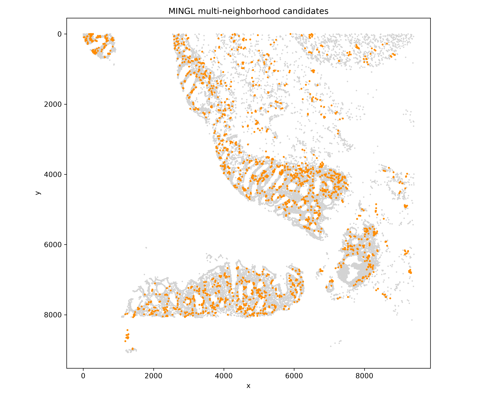
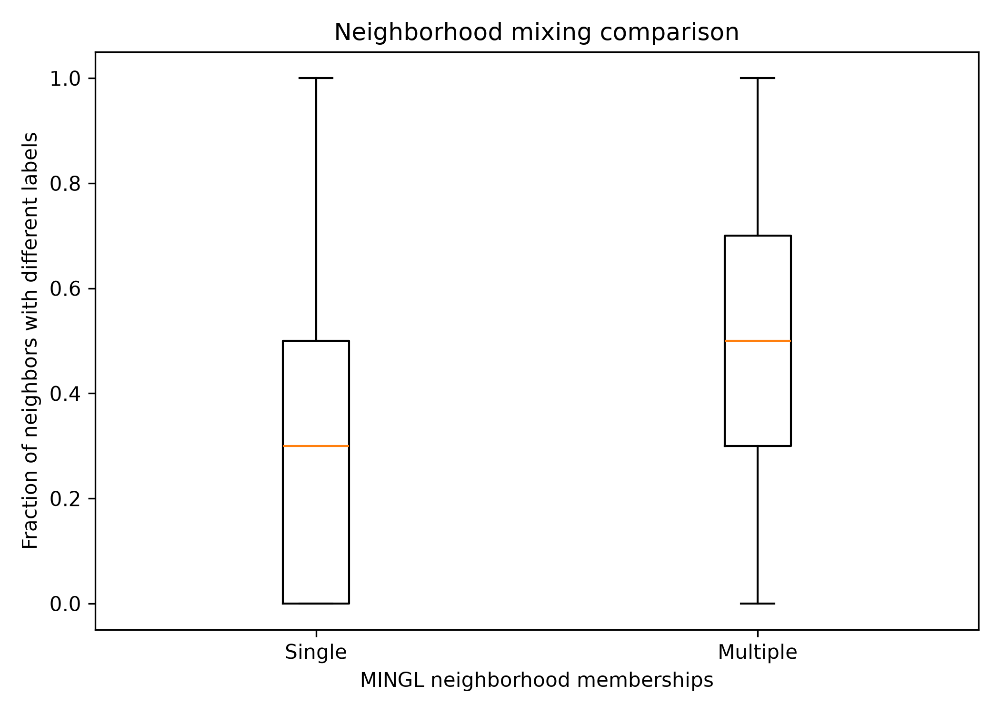
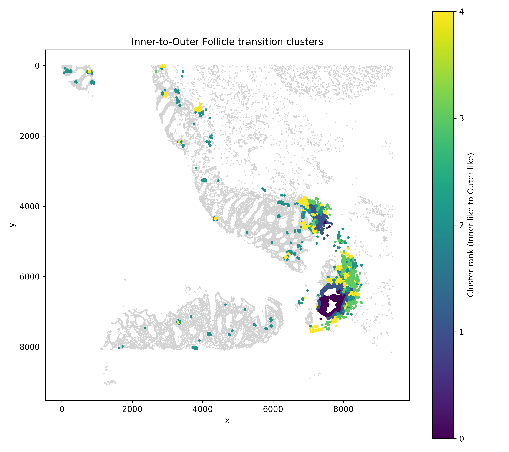
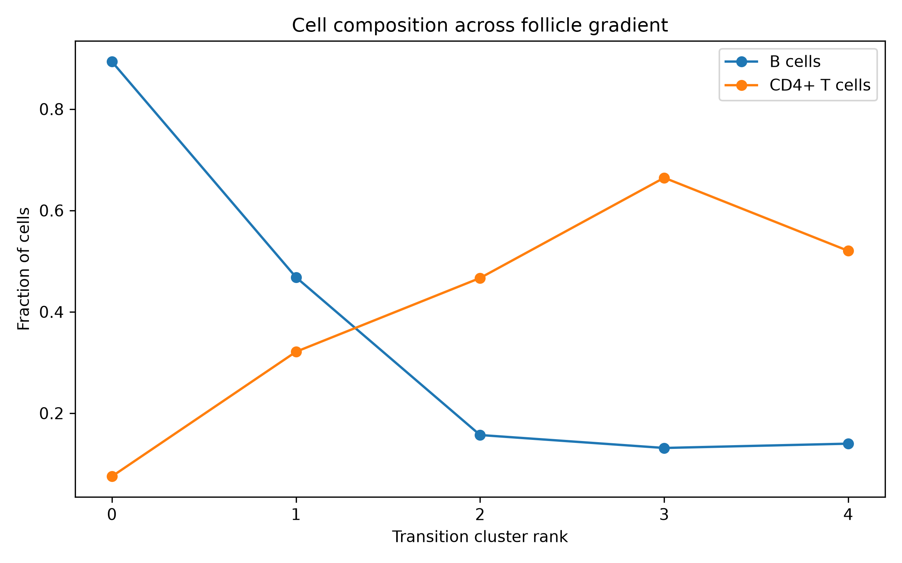
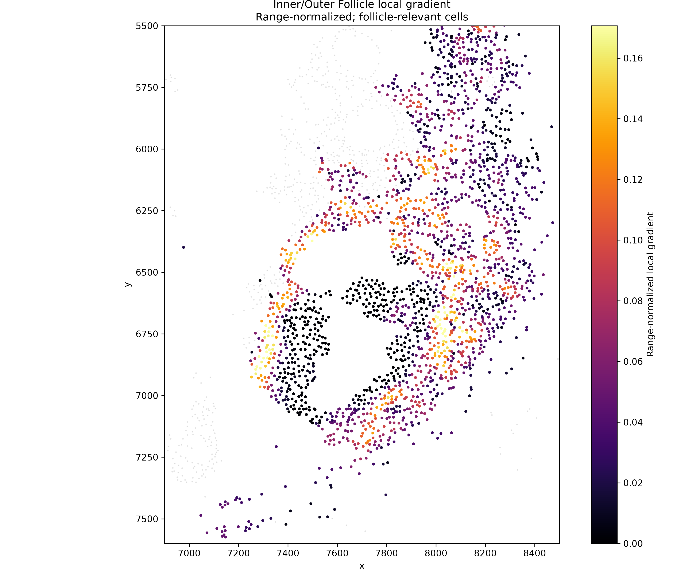

# Reproducing MINGL neighborhood and follicle-transition analyses

**Independent analysis of public CODEX intestine data | Zhixuan Zheng | November 2026**

I reproduced part of the [MINGL](https://github.com/HickeyLab/Mingl) workflow on one annotated human colon region, **B004_Ascending**. The analysis started with neighborhood membership probabilities, followed by a check of spatial neighborhood mixing, enrichment at shared-neighborhood interfaces, and a more detailed look at the transition between Inner and Outer Follicle.

The goal was to understand how the method describes spatial boundaries and changing cell composition, rather than develop a new model or claim an independent biological discovery. This is a **partial, exploratory reproduction**, not the complete set of analyses in the MINGL manuscript.

## Data and workflow

The input is the public merged CODEX intestine dataset. The selected region contains **21,232 cells**, with cell coordinates, annotated cell types, and previously assigned cellular neighborhoods. Using the official MINGL Python package (`mingle-hl` 0.1.0), I:

1. Calculated cell-type composition in local k-nearest-neighbor windows (`k=10`) and fitted neighborhood probability profiles.
2. Marked cells with at least two neighborhood membership probabilities greater than **0.25**.
3. Checked whether these cells tend to lie where nearby cells have different annotated neighborhood labels.
4. Examined shared membership between specific neighborhood pairs and ran the official cell-type enrichment plotting function.
5. Constructed a five-cluster Inner/Outer Follicle gradient using the official MINGL method (`k=20`, `random_state=42`).
6. Calculated MINGL's transition steepness and investigated local spatial gradient magnitudes.

The raw CODEX CSV, intermediate per-cell data, and saved AnnData objects are kept outside this repository.

## Results

### Multiple neighborhood memberships

Of 21,232 cells, **1,937 (9.12%)** had multiple neighborhoods with membership probability above 0.25: 1,900 cells had two memberships and 37 had three. The other 19,295 cells had one above-threshold membership.

Among the ten nearest *other* cells, the mean proportion carrying a different original `Neighborhood` label was **52.20%** for multiple-membership cells versus **31.61%** for single-membership cells.

This is an internal consistency check: the original neighborhood annotations contribute to MINGL's probabilities and also to the mixing measure. It should not be treated as independent validation of biological boundaries.

### Which neighborhoods share cells?

With both probabilities greater than 0.25, the largest pairs were:

| Neighborhoods | Shared-membership cells |
|---|---:|
| Outer Follicle / Inner Follicle | 174 |
| Transit Amplifying Zone / Secretory Epithelial | 173 |
| Transit Amplifying Zone / Plasma Cell Enriched | 155 |
| Plasma Cell Enriched / CD8+ T Enriched IEL | 98 |
| Stroma & Innate Immune / Stroma | 92 |

These counts represent overlapping probability assignments, not a histologically validated boundary length or a unique count of boundary cells.

### Inner–Outer Follicle gradient

The dataset has **1,240 Inner Follicle** and **2,282 Outer Follicle** annotated cells. Using the official MINGL transition clustering routine, the analysis placed these 3,522 cells into five clusters. The clusters are displayed from higher to lower mean Inner/Outer probability-ratio score, rather than by arbitrary clustering IDs.

| Ordered cluster | Cells | Mean score | B cells | CD4+ T cells |
|---|---:|---:|---:|---:|
| 0 (Inner-like) | 611 | 19.7013 | 89.36% | 7.53% |
| 1 | 660 | 5.0043 | 46.82% | 32.12% |
| 2 | 752 | -4.8759 | 15.69% | 46.68% |
| 3 | 784 | -7.8531 | 13.14% | 66.45% |
| 4 (Outer-like) | 715 | -14.5050 | 13.99% | 52.03% |

B-cell fractions were highest in the Inner-like cluster and much lower in the Outer-like clusters, while CD4+ T-cell fractions generally increased. Some larger follicles showed spatial layering of the ordered clusters. The trend is descriptive and does not establish a physical trajectory for individual cells.

The official `steepness_score` function returned **5.1316** (normalized slope: **0.4220**). This value depends on the clustering and scoring settings; it should not be compared numerically with a published example without matching the exact protocol.

### Local-gradient diagnostic

The initial local-gradient figure had unstable IQR normalization. Across all 21,232 cells, the score's actual interquartile range was only **6.08 × 10⁻¹⁷**; approximately **49.2%** of scores were exactly zero and **76.4%** of cells had a combined Inner/Outer probability below 10⁻⁸. The IQR denominator was effectively zero, inflating the default display scale.

I therefore re-expressed the previously calculated raw gradient magnitudes using the **full score range** and displayed only cells with `max(P_inner, P_outer) > 0.25`. This produced a readable exploratory figure of 3,455 follicle-relevant cells. Their range-normalized gradient had median **0.0471** and 99th percentile **0.1707**.

This is a **diagnostic alternative**, not the default MINGL normalization. The local regression itself was performed using all cells and then the visualization was restricted to follicle-relevant cells; strong values around interfaces are suggestive, not independently validated boundaries. The original unstable IQR-normalized figures are intentionally excluded.

## Reproduce

See [reproducibility notes](docs/reproducibility.md). The scripts in `scripts/` are the local analysis scripts used for this project; they call the original MINGL package rather than copying its implementation.

The analyses ran with **Python 3.11** and **MINGL 0.1.0** on Pop!_OS. The neighborhood-probability and local-gradient routines used the CPU implementation. An NVIDIA RTX 5090 was available on the workstation, but **GPU acceleration was not required for these specific MINGL runs**.

## Scope and limitations

- **One region from one donor**; this is not a patient-level replication.
- Neighborhood labels and cell types were supplied in the public dataset and were not inferred de novo.
- Original neighborhood annotations were also used in the mixing consistency check.
- The gradient function was run with `use_quantiles=False` and `random_state=42`; these parameters must be matched before comparing exact values with the paper.
- The local-gradient correction changes the normalization and visualization, not MINGL's probability model.
- No statistical evidence of new biological mechanisms or superiority over other methods is claimed.

For methods, detailed numbers, and figure interpretation, see the [research summary](docs/research_summary.md).

## References

- Van Batavia K, Wright J, Chen A, Li Y, Hickey JW. **MINGL: Quantifies Borders, Gradients, and Heterogeneity in Multicellular Tissue Organization.** [bioRxiv preprint](https://www.biorxiv.org/content/10.64898/2026.03.24.713296v1) (2026).
- [Hickey Lab / MINGL — original implementation](https://github.com/HickeyLab/Mingl).
- Public merged CODEX intestine dataset: see [data provenance](docs/reproducibility.md) and the original study's dataset documentation.

**This repository is independent of and not endorsed by the Hickey Lab.**
